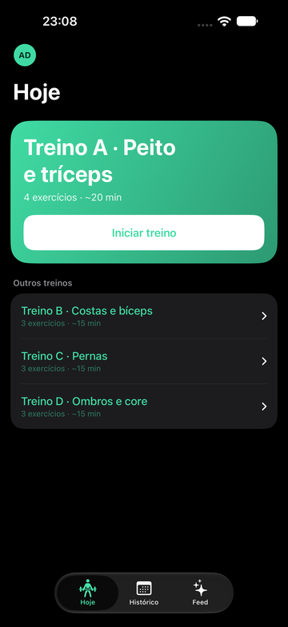
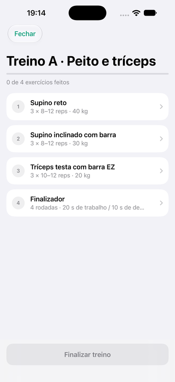
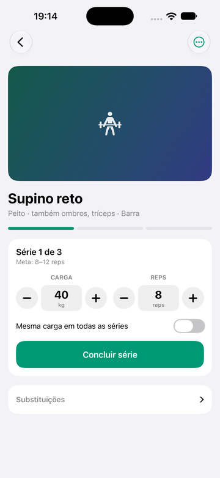
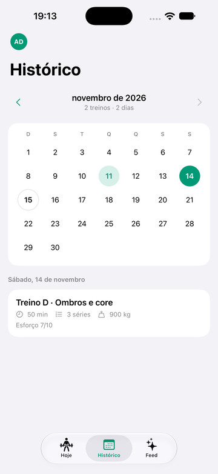
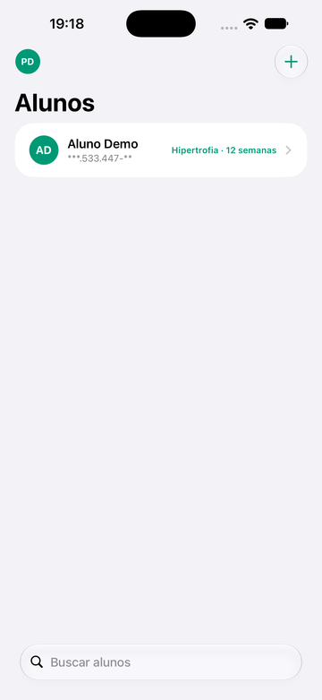
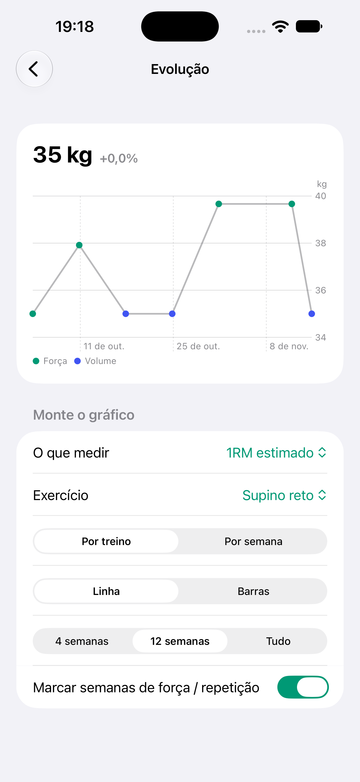
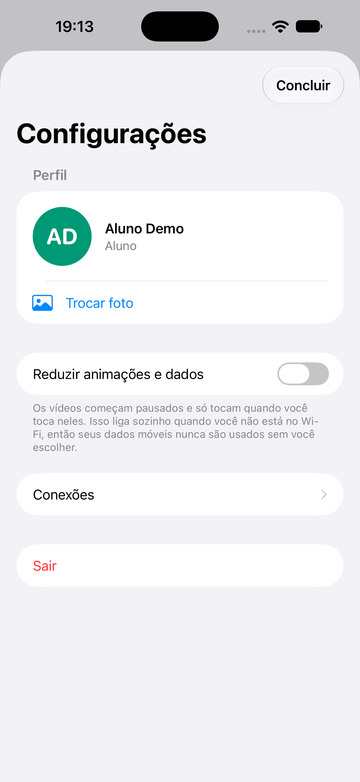

# FitCoach — iOS coaching app (Trainer ⇄ Student), offline-first

Native iOS 17+, SwiftUI, Swift Concurrency, Clean Architecture + MVVM, Firebase (Auth / Firestore / App Check),
SwiftData, CryptoKit/Keychain. This repository holds the **architecture, the data model, and the business logic
that carries the risk** — the sync engine, the progression analytics, the security layer — plus the app target that
wires them to Firebase and the OS.

[](https://github.com/EneasDavid/fitcoach-ios/actions/workflows/ci.yml)
[](https://github.com/EneasDavid/fitcoach-ios/actions/workflows/security.yml)
[](https://github.com/EneasDavid/fitcoach-ios/releases)


## Início rápido (pt-BR)

**FitCoach** é um app iOS para personal trainers e alunos: o personal cadastra o aluno (CPF + nome), monta os treinos, acompanha a evolução (métricas, histórico por dia,
medidas corporais, fotos) e pode **executar o treino junto com o aluno**; o aluno treina, vê o histórico em calendário e compartilha cartões no feed.

### Capturas de tela
Simulador de iPhone em **modo demonstração** (dados de exemplo, em português). O *Resumo* do personal, o *histórico completo por dia*, *Executar treino* e *Corpo* foram
criados depois destas capturas e ainda não têm imagem.

| Hoje (modo escuro) | Visão geral do treino | Exercício |
|:--:|:--:|:--:|
|  |  |  |

| Histórico (calendário) | Personal: alunos | Personal: evolução | Configurações |
|:--:|:--:|:--:|:--:|
|  |  |  |  |

### O banco de dados já está configurado?
**Não.** Este repositório **não tem nenhum banco configurado**: não existe projeto Firebase, e por isso não há `GoogleService-Info.plist`, nem URL do backend, nem
segredos. O app abre mesmo assim em **modo demonstração**, com dados de exemplo guardados só na memória do aparelho (nada é salvo na nuvem). Isso é automático: um build
**Debug** sem `App/GoogleService-Info.plist` entra sozinho na demonstração. Um build **Release** não faz isso de propósito: sem o arquivo ele falha, em vez de publicar uma demonstração por engano.

Os arquivos `*.example` mostram **o que preencher** (valores em branco; os reais ficam fora do Git, que ignora `.env`, `GoogleService-Info.plist`, `*.p8`):

| Arquivo de exemplo | Copie para | Para quê |
|---|---|---|
| [`.env.example`](.env.example) | `.env` | Time da Apple, chave do App Store Connect, `BACKEND_BASE_URL`, ids públicos (Spotify/Facebook), chave do NVD |
| [`functions/.env.example`](functions/.env.example) | `functions/.env` | Parâmetros das Cloud Functions (Strava, URL pública) |
| [`App/GoogleService-Info.plist.example`](App/GoogleService-Info.plist.example) | `App/GoogleService-Info.plist` | Formato do arquivo que o Firebase gera (use o **real**, baixado do console) |
| [`firebase/.firebaserc.example`](firebase/.firebaserc.example) | `firebase/.firebaserc` | Id do projeto Firebase para o `firebase deploy` |

**Para usar um banco de verdade (Firebase):**
1. Crie um projeto em console.firebase.google.com e ative **Authentication**, **Firestore** (região `southamerica-east1`) e **App Check**. As Cloud Functions exigem o plano **Blaze**
   (pago por uso, com cota gratuita).
2. Em *Configurações do projeto → Seus apps → iOS* (bundle id `com.fitcoach.app`), baixe o `GoogleService-Info.plist` e salve em `App/`.
3. `cp firebase/.firebaserc.example firebase/.firebaserc` e troque pelo id do seu projeto; publique as regras:
   `cd firebase && npm ci && npx firebase deploy --only firestore:rules,firestore:indexes`.
4. `cp functions/.env.example functions/.env`; defina os segredos (`npx firebase functions:secrets:set REGISTRATION_SECRET`, e os do Strava/Places se for usá-los) e publique:
   `cd functions && npm ci && npx firebase deploy --only functions`.
5. Coloque a URL das funções em `BACKEND_BASE_URL` (`.env`) e gere o app de novo. **Sem essa URL o primeiro acesso e a redefinição de senha ficam desligados.**
6. A conta do **personal** (login por CREF) precisa ser criada por um operador: ainda não há script para isso, e nada aqui valida o CREF no conselho. Para a redefinição de senha por
   e-mail, instale a extensão *Trigger Email from Firestore*.
Nada disso foi executado contra um Firebase real: é a configuração esperada, ainda **não verificada**.

### Duplicar o projeto em outro computador
Precisa de um **Mac** com **Xcode 26 ou mais novo** (o app usa APIs do iOS 26) e o [Homebrew](https://brew.sh).
```bash
git clone https://github.com/EneasDavid/fitcoach-ios.git
```
```bash
cd fitcoach-ios && brew install xcodegen node && xcodegen generate
```
1. `open FitCoach.xcodeproj` (o projeto é **gerado** a partir de `project.yml` e não vai para o Git: sempre rode `xcodegen generate` depois de clonar ou de mudar o `project.yml`).
2. Escolha um simulador de iPhone e rode (⌘R). **Sem `GoogleService-Info.plist` o app já abre em modo demonstração**, sem configurar nada. Opcional, em *Product → Scheme → Edit Scheme →
   Run → Arguments*: `-UITestStubCatalog` (catálogo de exercícios sem rede) e `-UITestTrainer` (abre direto na área do personal). Entradas da demonstração: aluno CPF `390.533.447-05` /
   senha `demo123`; personal CREF `012345-G/AL` / qualquer senha. Se você já colocou o plist do seu Firebase em `App/` e quer ver a demonstração mesmo assim, use o argumento `-UITestMode`.
3. Testes, sem precisar de Firebase real:
```bash
swift test
```
```bash
(cd functions && npm ci && npm test)
```
```bash
(cd firebase && npm ci && npm test)
```
   O terceiro precisa de **Java 21** (o emulador do Firestore). Os testes de interface rodam pelo Xcode (⌘U) num simulador de **iPhone**.
4. Opcional: `cp .env.example .env` e preencha o que for usar (TestFlight, URL do backend). Para o banco de dados real, veja a seção acima.
5. O projeto fica no Git; **nada de chave ou senha** deve ser copiado: leve só o repositório. Para colocar num iPhone de verdade ou no TestFlight é preciso uma conta paga da Apple (`scripts/testflight.sh --check`).

> O código é **todos os direitos reservados** (veja [`LICENSE`](LICENSE)): clonar para estudar e avaliar é permitido pelo GitHub; qualquer outro uso precisa de autorização do titular.

### Versões e releases
Versionamento semântico (`vMAJOR.MINOR.PATCH`), histórico no [`CHANGELOG.md`](CHANGELOG.md) e releases em [Releases](https://github.com/EneasDavid/fitcoach-ios/releases).
Versões **0.y.z são pré-releases** (desenvolvimento inicial); a linha **estável começa no 1.0.0**, com os critérios em [`docs/RELEASING.md`](docs/RELEASING.md). Cada tag publica,
pelo `release.yml`, o código-fonte, um SBOM (CycloneDX) e checksums. A aba *Packages* do GitHub fica vazia de propósito: o GitHub Packages não hospeda pacotes Swift (o SwiftPM usa as
tags do repositório) e este projeto vai para o TestFlight, não para um registro. Detalhes em `docs/RELEASING.md`.

### Segurança e licença
- Política de segurança e como reportar uma vulnerabilidade em particular: [`SECURITY.md`](SECURITY.md). O pipeline de segurança (OWASP) está descrito em [`docs/SECURITY_CI.md`](docs/SECURITY_CI.md).
- Licença: **todos os direitos reservados** (© 2026 David Ferreira), em [`LICENSE`](LICENSE).

---

## 1. Verification status — read this first

> Os números desta tabela vêm de um *snapshot* anterior e estão desatualizados (hoje há bem mais testes). O estado atual é o dos selos de CI acima e do `CHANGELOG.md`.


| Part | Compiled | Tests run | Notes |
|---|---|---|---|
| `Domain`, `SyncKit`, `SecurityKit`, `DataKit`, `PresentationKit` (Swift package, ~5.5 k lines) | ✅ Swift 6.4.2 compiler, Swift 5 language mode, **strict concurrency on**, macOS 14+ SDK | ✅ **204 tests, all passing** | Real Keychain, real certificates and OpenSSL-computed reference pins were used. |
| Line coverage of that code | | ✅ **96.5 %** (every module ≥ 92 %); 87.3 % if SwiftUI view bodies are counted | `scripts/coverage.sh` enforces the 70 % gate. |
| `App/` — Firebase gateway & listeners, SwiftData stores, UIKit feedback, BGTasks, composition root, screens (~1.2 k lines) | ✅ Xcode 27.2, iOS 27.2 SDK, Firebase iOS SDK 12.19.2 (`xcodebuild`, simulator) | ✅ runs in the iPhone simulator in demo mode (`-UITestMode`) | The first build had 2 compile errors (a non-public initialiser, an actor-isolation slip); both fixed. Production mode needs your `GoogleService-Info.plist` and has **not** been exercised against a real Firebase project. |
| `AppTests/`, `AppUITests/` | ✅ | ✅ **6 unit tests + 2 XCUITests passing** on the simulator | The SwiftData store passes the *same* `RecordStoreContract` as the in-memory/encrypted stores; Firestore value/error mapping verified; the XCUITests drive the real app (log a set → rest timer → RPE sheet; offline badge). |
| `firebase/firestore.rules` | ✅ loaded by the Firestore emulator 1.22 | ✅ **35 tests, all passing** (`cd firebase && npm install && npm test`) | Every write goes through a helper that mirrors the Swift gateway's transaction exactly. |
| `project.yml` (XcodeGen), `PrivacyInfo.xcprivacy` | ✅ project generates and builds | ✅ (via the app tests) | `.github/workflows/ci.yml` is still **unrun**. |

**Deviation from the brief — Swift Testing instead of XCTest for unit tests.** The build machine has only the Command
Line Tools, which ship Swift Testing but not XCTest, so XCTest tests could not have been run at all. Swift Testing is
Apple's current framework, runs in the same Xcode test action, produces the same coverage data, and coexists with
XCTest. The XCUITest suite is XCTest (it must be). Converting the unit tests is mechanical if you prefer XCTest.

## 2. Architecture

```
                     ┌────────────────────────── App target (Xcode, iOS only) ───────────────────────────┐
                     │ composition root · Firestore gateway · SwiftData stores · UIKit · BGTasks · CoreLocation │
                     └───────┬───────────────┬───────────────┬──────────────┬───────────────┬────────────┘
                             ▼               ▼               ▼              ▼               ▼
                       PresentationKit     DataKit         SyncKit      SecurityKit        (OS / Firebase)
                       SwiftUI + VMs    offline-first    mutation queue  Keychain, AES-GCM,
                       component factory repositories    dispatcher      SPKI pinning
                             │               │
                             └───────┬───────┘
                                     ▼
                                   Domain      ← entities, engines, use cases, repository *protocols*; Foundation only
```

Each layer is a separate SwiftPM module, so the **dependency rule is enforced by the compiler**: `Domain` cannot
import Firebase, SwiftData or UIKit; `SyncKit` and `SecurityKit` know nothing about fitness. Firebase and SwiftData live
behind two small ports (`RemoteGateway`, `LocalRecordStore`/`MutationStore`), so replacing either is a change in one file.

Patterns: **Clean Architecture** (above), **MVVM** (`@Observable` view models, thin views), **SOLID**
(ports/adapters, one reason to change per type), **Factory** in three places — `WorkoutComponentFactory` (block kind →
view model + view, registry-based, forward-compatible), `GymArrivalProviderFactory` (which arrival sources are active),
and the `AppContainer` composition root / `AppViewFactory` (role → screen shell).

### Directory structure
```
Package.swift                    5 library modules + 5 test targets
Sources/
  Domain/                        Foundation only
    Entities/                    UserProfile, Exercise, WorkoutPlan/Template/Block, Periodization, WorkoutLog,
                                 BodyComposition, GymCheckIn, SyncMetadata, typed Identifiers
    Engines/                     ProgressionEngine ★, WorkoutSequencer ★, AdherenceCalculator, CadenceAnalyzer
    UseCases/                    Start/RecordBlock/FinishWorkout, GymArrivalCoordinator
    Repositories/                ports: plan/log/check-in/body/catalogue repos, LocalNotificationScheduling
  SyncKit/                       JSONValue + SyncCoding, Mutation, MutationQueue ★, SyncDispatcher ★,
                                 ConflictResolution, BackoffPolicy, NetworkMonitoring, RemoteGateway (port)
  SecurityKit/                   KeychainStore, TokenStore, FieldCipher (AES-GCM + HKDF), CertificatePinning
  DataKit/                       LocalRecordStore (+ sealed/encrypted decorator), OfflineFirstStore<E> ★,
                                 repository adapters, exercise catalogue cache, gym provider factory/simulator
  PresentationKit/               view models, WorkoutComponentFactory ★, SwiftUI views, charts
App/                             composition root, Firebase gateway+listeners, SwiftData, notifications, BGTasks,
                                 geofence, student home — see §1
Tests/ AppTests/ AppUITests/     unit (Swift Testing) · app-level · XCUITest
firebase/                        firestore.rules, firestore.indexes.json
scripts/                         coverage.sh, check_coverage.py (the 70 % gate)
```
★ = the three pieces you asked for explicitly.

## 3. Data model & Firestore schema

"Decentralised sync" is implemented as: **each user's data is a self-contained, partitioned subtree; every device is
a full replica that works alone; Firestore is the convergence point** — not peer-to-peer.

| Path | Written by | Read by | Notes |
|---|---|---|---|
| `users/{uid}` | self (create once) | self, linked trainer | `role` fixed after create; `trainerID` server-set |
| `trainerLinks/{trainerId}_{studentId}` | **Cloud Function only** | the two parties | `status: active`; **all trainer access derives from this**, never from `role` |
| `plans/{planId}` | owning trainer | trainer + assigned student | per-student plan: templates (ordered rotation), periodization, `studentID`, `trainerID` |
| `students/{sid}/workoutLogs/{logId}` | the student | student + linked trainer | sets/HIIT/cardio embedded; RPE; **frozen periodization snapshot** |
| `students/{sid}/checkIns/{id}` | the student | student + linked trainer | gym arrivals |
| `students/{sid}/bodyCheckpoints/{id}` | linked trainer | student + trainer | end-of-cycle weight / body-fat / lean mass |
| `exerciseCache/{externalId}` | Cloud Function | any signed-in user | catalogue proxy cache; vendor API key never ships in the app |

Every syncable document embeds the same bookkeeping, which is what makes offline sync correct:

```jsonc
{
  "id": "…", "studentID": "…", "planID": "…", "status": "completed", "startedAt": <Timestamp>, "rotationIndex": 3,
  "periodization": { "weekIndex": 3, "phase": "deload", "volumeMultiplier": 0.5, "intensityMultiplier": 0.85 },
  "blocks": [ { "type": "resistance", "blockID": "…", "exercise": {"id":"…","name":"Back Squat"},
                "sets": [ { "index": 1, "weightKg": 60, "reps": 8, "restTakenSeconds": 85, "completedAt": <Timestamp> } ] },
              { "type": "hiit", … }, { "type": "cardio", … } ],
  "sessionRPE": 7,
  "meta": { "version": 12, "updatedAt": <Timestamp>, "lastWriterDeviceID": "…", "deletedAt": null },  // client-owned
  "_rev": 5, "_mutationId": "…", "_updatedAt": <server Timestamp>                                      // gateway-owned
}
```
* `meta.version` — client revision counter (bumped by the repository, which *owns* `meta`).
* `_rev` — server revision, the thing optimistic concurrency checks. `_mutationId` — idempotency key.
* **Sync flags** (`SyncState`: `synced · pendingUpsert · pendingDelete · conflict · failed`) are **local-only** columns on
  the local record and never serialised (tested).
* Deletes are tombstones (`meta.deletedAt`); rules forbid hard deletes.
* Block types use a flat discriminator (`"type":"hiit"`). A block type from a newer app version decodes as `unsupported`
  (tested) so an older student build can still open the rest of the plan.

## 4. Offline-first sync (`SyncKit` + `DataKit`)

```
 save(entity) ─► ① encrypted local write (state = pending) ─► ② durable MutationQueue.enqueue ─► ③ kick dispatcher
      ▲                                  │ rollback if ② fails                                          │
      └────── UI reads ONLY the local store (observe → AsyncStream)                                     ▼
                                                                  SyncDispatcher ─► RemoteGateway (Firestore tx) ─► observer
                                                                       ▲ reconnect / backoff wake-ups / BGTask        │
                                                                       └──── LocalSyncStateUpdater flips rows to `synced`
```
No UI path waits on the network, and everything runs in actors off the main thread.

| Concern | Behaviour (all covered by tests) |
|---|---|
| Durability | `enqueue` is the durability point — it throws if the edit can't be persisted; the local write is rolled back. |
| Coalescing | 5 sets logged offline → **one** upsert. Create-then-delete offline cancels out. Never merges into an in-flight write. |
| Ordering | Per document, strictly. A backed-off document never stalls unrelated ones. |
| Idempotency | Lost ack → replay recognised by `_mutationId`; applied exactly once. |
| Optimistic concurrency | Server transaction compares `baseVersion` to `_rev`. Edits made *while* an earlier write is in flight adopt the new revision (no self-conflict). |
| Conflicts | Policy per collection: logs/check-ins **client wins** (the student's device is authoritative); plans/checkpoints **last-write-wins**; `users` **merge keeping server-owned fields**. A lost conflict re-fetches the server copy and clears the pending flag. |
| Failures | `offline` (stop, don't burn attempts, probe later) · `transient` (exponential backoff + jitter, honours `retryAfter`, dead-letter after 8) · `unauthenticated` (pause the whole queue until re-login) · `permissionDenied/invalid` (dead-letter, others continue). |
| Crash recovery | `inFlight` is memory-only; after a restart those mutations are pending again; replay is safe (idempotency). |
| Inbound | Snapshot listeners → `applyRemote`; a server copy never overwrites a queued local edit; stale/duplicate snapshots ignored. |

**Decision worth knowing:** Firestore's own SDK already persists offline writes. Running two queues would double-apply
and make failures opaque, so the Firestore client is configured with a **memory-only cache** (`FirebaseBootstrap`) and
`MutationQueue` is the single owner of pending writes. The price: no Firestore-side offline *reads* — reads come from
the encrypted SwiftData replica instead, which is what the brief asked for.

## 5. Business logic

### Progression engine & deload normalisation (`ProgressionEngine`)
* Per session and exercise: best **estimated 1RM** (Epley by default; Brzycki/Lombardi available) over working sets
  of ≤ 12 reps, plus tonnage. Warm-ups are excluded.
* **Deload (low-load) weeks are recorded but never counted**: they're excluded from the regression trend and verdict,
  from personal records, and from the "previous session" baseline — so the first week after a deload is compared with the
  last week *before* it, not with the deload. Their x-position is collapsed out, so the slope is *kg per training-effective
  week* and a deload neither dents nor stretches the line. Deload weeks the student skipped still collapse (the plan is consulted).
* Non-deload volume is **normalised by the week's planned volume multiplier**, so a planned 85 % week is comparable to a 100 % one.
* The phase comes from a **snapshot frozen on the log at start time**, never from the current plan: editing periodization
  later cannot rewrite history.
* Verified, among others: the 12-week 3:1 program yields a slope of exactly 2.5 × (1 + 5/30) kg/week with R² > 0.999999,
  while naive analysis of the *same* data gives R² < 0.9 and an under-reported slope; removing the deload logs entirely
  leaves the trend identical (to 1e-9).

### Other engines
* **`WorkoutSequencer`** — next workout = successor of the *last completed* template, never the weekday. Completed/skipped
  advance, abandoned doesn't; a fresh in-progress session is resumed, a stale one (> 8 h) is ignored; a template removed by a
  plan edit falls back to the least-recently-performed one. `rotationIndex` drives sequence-based periodization (a missed
  week can't skip a student into a deload they haven't earned; calendar-based is available).
* **`AdherenceCalculator`** — expected vs completed sessions, prescribed vs completed sets/reps, rest compliance.
* **`CadenceAnalyzer`** — learns usual training (weekday, hour) slots and plans the next week of local reminders;
  `ReminderRefresher` + a `BGAppRefreshTask` keep them current.
* **Gym check-in** — `GymArrivalCoordinator`: arrival → de-duplicated (in memory *and* persisted) → check-in saved → today's workout
  announced with a deep link; the log is created on tap, so walking in and out never litters history. **Smart Fit / Wellhub
  (Gympass) / Gymrats do not publish open check-in APIs** — real adapters need a partner agreement and plug in via
  `GymArrivalProviding`. What works without one: the CoreLocation **geofence** adapter (on-device, relaunches the app on entry).
  A simulator provider covers demos and tests.

### Dynamic workout rendering (`WorkoutComponentFactory`)
A template is a heterogeneous, ordered block list (HIIT/cardio sit *inside* the resistance flow). Each block kind registers one
builder → `WorkoutComponent{viewModel, view}`. New kinds plug in by registration; unknown kinds render a placeholder that never
blocks finishing the workout. Resistance blocks implement real-time load logging, **"same load for all sets"** propagation,
an adjustable (±15 s) rest timer derived from an end date (correct across suspension) with haptic/sound and a background
local-notification alert, prefill from last session, and per-set persistence.

## 6. Security (OWASP Mobile Top 10, 2024)

| # | Control | Where | Tested here |
|---|---|---|---|
| M1 Credentials | No keys in the binary; exercise-API key stays behind a Cloud Function; third-party tokens in the Keychain (`…ThisDeviceOnly`, never iCloud-synced) | `SecureStore`, `TokenStore` | ✅ |
| M2 Supply chain | One third-party dependency (Firebase). Commit `Package.resolved`, enable Dependabot | `project.yml` | — |
| M3 Authn/authz | Firebase Auth; **rules never trust client `role`** — trainer access only via server-written `trainerLinks`; App Check (App Attest) | `firestore.rules`, `FirebaseBootstrap` | ✅ rules (35 emulator tests); App Check ❌ |
| M4 Input/output validation | Domain validation (RPE 1–10, body-comp ranges, clamped loads/reps, cardio inputs) **and** shape/range checks in rules | entities, VMs, rules | ✅ |
| M5 Communication | ATS (no exceptions) + SPKI pinning for first-party `URLSession` traffic (current + backup pin, fail-closed; system trust is always evaluated first) | `CertificatePinning` | ✅ pin hashes match OpenSSL |
| M6 Privacy | On-device-only location, selected gyms only, privacy manifest, no analytics/ad SDKs (no health data is logged — keep it that way, or use `os.Logger` with `.private`); health-data consent + in-app account deletion with server erasure are **required before launch** | `GeofenceArrivalDetector`, `PrivacyInfo.xcprivacy` | — |
| M7 Binary protections | App Attest via App Check. Jailbreak detection deliberately not included (easily bypassed; adds false positives) | `FirebaseBootstrap` | — |
| M8 Misconfiguration | Rules default-deny, no hard deletes, minimal entitlements/background modes, script sandboxing | rules, `project.yml` | — |
| M9 Data storage | **AES-256-GCM field encryption** of every record and queued mutation; plaintext only for non-sensitive query columns; file protection `completeUntilFirstUserAuthentication` (so background sync works while locked); excluded from backups; **crypto-shredding on sign-out** | `FieldCipher`, `SealedRecordStore`, `SwiftDataStores` | ✅ (ciphertext on "disk", row-swap detection, shredding) |
| M10 Cryptography | CryptoKit only (no custom crypto); random nonces; HKDF per-purpose subkeys; ciphertext bound to its row via AAD; versioned keys for rotation | `FieldCipher` | ✅ tamper, wrong context, rotation |

Pinning caveat: it **cannot** protect Firebase traffic (gRPC, own TLS stack; Google rotates certificates too often to pin
safely). App Check + ATS cover that path. Pin only your own domains, always with a backup pin.

## 7. Testing & the 70 % gate

```bash
scripts/coverage.sh                 # (on a Command-Line-Tools-only machine it passes the Swift Testing macro-plugin path itself)
                                    # runs all unit tests, builds ONE report across every test bundle, enforces ≥ 70 %
COVERAGE_MIN=80 scripts/coverage.sh # tighten the gate
```
Current result: Domain 96.8 % · SyncKit 95.0 % · DataKit 99.6 % · SecurityKit 92.6 % · PresentationKit 95.5 % · **total 96.3 %**.
SwiftUI view bodies are excluded from the gate (declarative layout, all logic is in the counted view models; they're covered by
XCUITest) — the script prints the with-views figure (87.1 %) so the exclusion is visible.

How the suite is organised so the standard *stays* maintained:
* **Pure logic is tested with deterministic fixtures** (fixed UTC calendar, injected clocks/randomness, no sleeps — async work is awaited with `eventually {}`).
* **A server simulator** implementing the real gateway contract (OCC, idempotency, scripted failures, lost acks, blocking gates) drives the dispatcher through every failure mode.
* **Contract tests**: `RecordStoreContract` runs against the in-memory, the encrypted *and* (in the app target) the SwiftData store.
* **Independent oracles**: SPKI pins compared with OpenSSL output; Keychain tests use the real Keychain.
* **Bugs the tests caught while building this** (kept as regression tests): Keychain `removeAll` deleting only one item on macOS; the unsupported-block placeholder losing the block's original type name; prefilled loads not carrying forward to later sets; the app crashing when launched as a unit-test host (no Firebase config) — it now detects test hosting and runs in demo mode; and a duplicate dynamic Firebase link when both the app and the test bundle depended on it.
* **A rules bug the emulator caught:** the `plans` read rule evaluated `resource.data` on a document that doesn't exist yet, but the gateway's transaction *reads before it creates* — so no plan could ever have been created. Fixed by splitting `get`/`list` (`resource == null` allowed for `get`, which reveals only that an id is unused).
* CI (`.github/workflows/ci.yml`): package job with the coverage gate, a rules job, then the app job (`xcodebuild test`) — **unrun**.

## 8. Getting to TestFlight

Nothing can be uploaded from this repository on its own: a TestFlight build needs **your** Apple Developer account, your signing and your
backend. `scripts/testflight.sh --check` looks at the machine and lists what is still missing (it builds and uploads nothing).

What the repository already proves: the **Release** configuration archives for `generic/platform=iOS` (checked unsigned), and the package,
rules, functions and UI suites pass (see the verification notes below).

What only you can provide:

1. **Apple**: a paid Developer Program team (`DEVELOPMENT_TEAM`), an app record for `com.fitcoach.app` in App Store Connect, and an App Store Connect
   API key (`.p8`; `ASC_KEY_ID`, `ASC_ISSUER_ID`, `ASC_KEY_PATH`). Keep the key on your machine or in CI secrets — never in the repo, never in a chat.
2. **Firebase (production project)**: Auth + Firestore + App Check (App Attest); put `GoogleService-Info.plist` in `App/` (git-ignored).
   `cd firebase && npm install && npm test`, then `firebase deploy --only firestore:rules,firestore:indexes`.
3. **Cloud Functions** (`functions/`): `firebase functions:secrets:set REGISTRATION_SECRET` (long, random), then deploy. Set `BACKEND_BASE_URL`
   to `https://southamerica-east1-<project>.cloudfunctions.net`; **without it first access and password reset are switched off in the build**.
4. **Password-reset e-mail**: the function writes the message to the `mail` collection. Install the *Trigger Email from Firestore* extension (or any worker
   reading that collection). Without it the reset request succeeds but no e-mail is ever sent.
5. **Export compliance** (`ITSAppUsesNonExemptEncryption`) and the privacy answers: decide with your compliance owner; `App/PrivacyInfo.xcprivacy` lists
   name, user id, e-mail, photos, fitness and health data (height, weight, BMI, bioimpedance) — review it, and the CPF question noted in the file.
6. Before **external** testers / the App Store (not needed for internal TestFlight): in-app account deletion with server-side erasure and an explicit
   health-data consent screen — **neither exists yet**.

Then:

```bash
DEVELOPMENT_TEAM=ABCDE12345 BACKEND_BASE_URL=https://… scripts/testflight.sh            # archive + export an .ipa, uploads nothing
DEVELOPMENT_TEAM=ABCDE12345 BACKEND_BASE_URL=https://… ASC_KEY_ID=… ASC_ISSUER_ID=… ASC_KEY_PATH=~/keys/AuthKey_XXXX.p8 \
  scripts/testflight.sh --upload                                                         # sends it to App Store Connect → TestFlight
```

To just look at the app without Firebase: a **Debug** build with no `App/GoogleService-Info.plist` opens in demo mode by itself (`AppEnvironment.detect`); with a plist present,
or to force it, launch with `-UITestMode`, e.g. `xcrun simctl launch <udid> com.fitcoach.app -UITestMode` (in-memory stores, a loopback "server", seeded demo data; add
`-UITestTrainer` to open in the personal trainer's area). A **Release** build never falls back to the demo: a missing plist there is a packaging error and must fail.

## 8b. CI/CD and security pipeline

`.github/workflows/ci.yml` runs every regression suite (functions, Firestore rules in the emulator, package tests with the 70 % coverage gate, app + XCUITest on an
iPhone simulator); `.github/workflows/security.yml` adds secret scanning, Semgrep (OWASP Top 10 rules), OWASP Dependency-Check, npm audit + a CycloneDX SBOM,
MASVS/API-Top-10 static checks, a hardening check of the workflows themselves (OWASP CI/CD Top 10), and opt-in CodeQL and OWASP ZAP. What it does and does not
prove, and the one-time repository settings it expects, are in [`docs/SECURITY_CI.md`](docs/SECURITY_CI.md). Run the local checkers with
`python3 scripts/ci/masvs_static_checks.py`, `python3 scripts/ci/check_workflows.py` and `python3 -m unittest discover -s scripts/ci -p 'test_*.py'`.

## 9. Known gaps / decisions you may want to revisit

* **Not built:** Cloud Functions, the Sign-in screen, trainer roster + plan-builder *screens* (their view models `PlanBuilderViewModel`/`StudentProgressViewModel` are done and tested; `ProgressionChartView` exists), localisation catalogs, iPad layout, accessibility audit, weight units other than kg.
* **Self-service trainer sign-up:** rules let a user pick `trainer` at sign-up (it grants nothing without a server-written link). Gate it server-side if that is not what you want.
* **Last-write-wins uses client clocks** for the edit time (server time for the other side); skew can mis-pick in rare trainer-on-two-devices cases. Logs avoid it (client wins).
* **Rest-taken** is estimated as (gap between sets − reps × 3 s); there is no explicit "start set" tap.
* **Sign-out loses unsynced edits** (crypto-shredding by design) — the UI must warn when `SyncStatus.pending > 0`.
* **Plan versions:** editing a plan mid-cycle affects future sessions only; history keeps its snapshot, but there's no plan version history UI.


## Gym detection, Strava, music and shareable cards

**What exists and is verified** (package tests, rules emulator, node tests, simulator UI tests):
- *Automatic start*: enter/exit events → `GymVisitTracker` (pure dwell logic) → `GymPresenceCoordinator` starts today's workout after 30 min inside the perimeter, dated from arrival, linked to the check-in, never twice, never over a live/just-finished workout. iOS cannot run a background timer, so the design is event-based: a local notification is scheduled at enter+30 min, cancelled on exit, and any wake (foreground, BGTask, region event) re-evaluates open visits.
- *Feed*: workout / PR (with the song playing when the set was completed) / playlist-of-the-day / Strava cards, rendered to a 1080×1920 poster; share to WhatsApp (text), Instagram Stories (image via pasteboard, needs a Meta App ID) or the system sheet (Gymrats has no public API — it only receives the card through the share sheet).
- *Trainer report*: `ActivityReportViewModel`/`ActivityReportView` (app workouts + Strava the student chose to share). There is no trainer roster screen in this project yet, so it is not hosted anywhere.
- *Backend* (`functions/`): Strava OAuth + webhook (events are unsigned → validated, queued, and always refetched with the athlete's own token) and a Google Places proxy (key server-side, rate-limited, App Check + ID token).
- *Rules*: `externalActivities`/`integrations` are server-write-only; a trainer reads Strava data only if the student opted in AND `config/features.stravaCoachSharing` is true (fail-closed).

**Constraints you must know before shipping**
- **Spotify**: `recently-played` only reaches the last ~50 plays; Development Mode is limited to 5 users and needs Premium; production needs Extended Quota (reported threshold ~250k MAU — verify). `played_at` semantics are assumed to mark the *end* of a play (one flag in `SpotifyHistoryClient`) — verify with live data. Raw plays stay on the device (90-day retention); only the few tracks quoted in a post are synced.
- **Strava**: since Nov 2024 the API terms limit showing an athlete's data to that athlete; whether a consenting coach counts as "another user" is unresolved. Coach visibility is therefore off by default behind a server flag — get Strava's written answer before enabling it.
- **Google Places**: coordinate caching limits were not verified (check Maps Platform terms); `MapKitGymLocator` is the keyless default.
- **Not verified**: anything against real Firebase, Strava, Spotify, Google or Meta credentials; geofence events on a physical device; CI workflow.
- *(pt-BR localization, the trainer area and the coverage re-run were done afterwards — see the next section.)*


## Personal trainer, student onboarding, profile and data saver

**Flow.** The personal registers a student with **CPF + name** → the student's *first access* repeats both, then fills in e-mail, age,
gender and a password → the student has **no workouts** until the personal creates them. Only the trainer can create or edit workouts
(Firestore rules: plans are writable only by the owning trainer; the student app has no editor at all).

**What exists and is verified** (package tests, node tests, rules emulator, simulator UI tests on an iPhone):
- *Registration & first access*: `RegistrationDirectory` (in-memory, used by demo and UI tests) and `BackendRegistrationClient` (HTTP to the
  functions below). "Not found" is the same answer for an unknown CPF and a wrong name, so the screen can't be used to discover which CPFs exist.
- *Cloud Functions* (`functions/lib/registrations.js`, wired in `index.js`): `registerStudent`, `claimRegistration`, `completeRegistration`,
  `loginAlias`. The CPF is never stored or used as an id: the registration id and the login name are **HMAC**s keyed by a server secret
  (`REGISTRATION_SECRET`) — an unkeyed hash of a CPF can be brute-forced. The student's login alias is an opaque `…@students.fitcoach.invalid`;
  the *password* is checked by Firebase Auth. Unauthenticated endpoints need App Check and are rate-limited.
- *Trainer area*: student list with search, private **nickname** per student (only the trainer sees it — it lives in `trainers/{id}/nicknames`,
  which no student account can read, proven by rules tests), workouts editor (days A–D, exercises from the catalogue, sets/reps/load/rest),
  and **individual progress charts the trainer builds** (metric: estimated 1RM, heaviest load, volume, sets, reps, **rest time**; one exercise
  or all; per workout or per week; line or bars; 4 weeks / 12 weeks / all; strength/volume weeks marked). The choice is remembered per student.
- *Strength weeks / volume weeks*: the trainer sets "N weeks of strength, M of volume" (plus suggested rep ranges). Each workout freezes which kind
  of week it was. If the student lifts the wrong way round — **a load above their best strength-week load during a volume week** ("focus on
  execution"), or below their best volume-week load during a strength week — the exercise screen shows a warning and a haptic. It is advice; it never blocks a set.
- *Profile at the top-left, always*: the student's photo (or initials) is on every main screen; tapping it opens settings — profile (name, photo,
  log out), **Reduce motion & data**, connections. The photo is stored on the device only (encrypted), downsized to ≤ 512 px.
- *Reduce motion & data*: videos start **paused** and download only after a tap. It switches on **by itself when the phone isn't on Wi-Fi**
  (cellular, hotspot or Low Data Mode), in Low Power Mode, and with the system's Reduce Motion. Off that, the muted clip loops by itself.
- *Video*: exercise clips come from wger.de (CC-BY-SA, credit shown), always muted, no controls. (The demo launched with `-UITestStubCatalog` has no clips; without it they load from wger.)

**Honest limits**
- Production sign-in for CPF/CREF needs the functions deployed with `REGISTRATION_SECRET`; trainer accounts must be created by an operator
  (the alias of a CREF is `loginAlias(secret, normalizedCref)`), and nothing here verifies a CREF against the council's registry.
- The functions, the Firebase auth services in `App/Firebase/` and the first-access sign-in have **not been run against a real Firebase project**.
- The nickname/registration rules are tested in the emulator; the *UI* guarantee that a student never sees a nickname is tested in demo mode only.
- Built afterwards: live coaching, photos the trainer can see, body data and the student's view of their trainer (next section).
- Still not built: a trainer schedule by time slot, reordering exercises mid-session, and saving a mid-session exercise change back into the plan.
- No UI test was run on an iPad this round (by request); the iPad layout is covered by the earlier run and the adaptive-width code.


## Trainer follow-up, live coaching, body data, photos, password reset

**What exists and is verified** (package tests, rules emulator, node tests; simulator UI tests on an iPhone — see the status line at the end):
- *Summary* (`TrainingMetricsBuilder`, pure and tested): attendance against the plan's weekly target; volume load, sets, reps, minutes and session-RPE load per
  week; acute : chronic load (flagged from 1.5; needs three weeks of history); estimated 1RM per exercise with new bests and "no new best in the last 3 workouts";
  sets done, reps inside the planned range, planned load reached and **rest on target** against the plan; load per rep and work per minute; hard sets per
  muscle over 7 days. They are advisory signals, each with what it is made of — not verdicts. Sources: Scott et al., *Sports Med* 2016 (monitoring),
  Schoenfeld et al., *J Sports Sci* 2016 (weekly sets); thresholds are conventions, not clinical limits.
- *History by day, complete*: the calendar opens a day and then a workout with **every set** (load, reps, effort, rest taken, time of day) next to what the plan
  asked for, HIIT and cardio blocks, replaced exercises, the note, and the photos. The student reads the same record.
- *Run workout*: the trainer runs the student's workout on their own phone (loads, sets, rest timer, finish with effort), can **choose any other exercise** and
  **add one**. The session is a `WorkoutLog` marked `coachedBy`, stored in `students/{id}/coachedLogs` — a collection only the linked trainer can write — and
  `MergedWorkoutLogRepository` shows it to everything that reads history, so the student's calendar, rotation and the metrics include it with no special case.
  A student can neither start, resume nor edit it (rules + sequencer), and cannot present their own log as coached.
- *Body*: height and weight at first access (required, server-validated); BMI with WHO adult bands (no label under 18); the trainer adds measurements — weight and, all
  optional, body fat, fat/lean/skeletal-muscle mass, body water, visceral fat, bone mass, BMR, metabolic age, waist, hip. The student sees it read-only.
- *Photos*: a photo the student attaches is mirrored into `sharedPhotos` (the only part of a card the trainer reads — cards, which can carry the songs
  that were playing, stay private). The card says "Your trainer can see this photo".
- *Trainer details*: the trainer's name, photo and **CREF** (`trainerProfiles/{id}`, written by the trainer, readable by their own students); the student sees it in settings.
- *Sign-in*: CPF gets its dots and dash as it is typed; first-access fields keep visible labels; **forgot password** = CPF + the e-mail registered at first access →
  a 6-digit code (HMAC-stored, 15 min, 5 tries) e-mailed to the *registered* address → new password, other sessions revoked. Unknown CPF, wrong e-mail and
  inactive account all answer the same.

**Honest limits**
- None of the backend, the Firebase services or the new listeners was run against a real Firebase project; the rules are tested in the emulator (including that a
  student can query exactly their trainer's profile document), the functions' decisions with node tests.
- The password-reset e-mail depends on the `mail` extension being installed (see §8); students only — trainers (CREF) have no reset.
- Photos are kept in the Firestore document (≤ ~300 KB each); no Cloud Storage yet.
- The coached session's changes of exercise are session-only; the plan is edited from "Edit workouts".
- Not done: in-app account deletion, a health-data consent screen, an accessibility audit of the new screens, the iPad run (by request).

